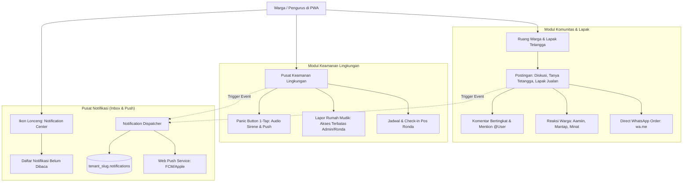

# Spesifikasi Desain: Ekosistem Komunitas, Keamanan Warga & Pusat Notifikasi Terpadu

> **Status:** Draft / Awaiting Review  
> **Tanggal:** 2026-10-03  
> **Target Branch:** `dev`  
> **Dokumen Terkait:** `docs/02-modules/notifikasi-webpush.md`, `docs/08-roadmaps/community-features-roadmap.md`

---

## 1. Visi & Tujuan Bisnis

Transformasi SiTransparan RT/RW dari platform pencatatan birokrasi & kas pasif menjadi **Platform Komunitas & Kehidupan Bertetangga yang Hidup (Hyperlocal Neighborhood Ecosystem)**.

Tiga pilar utama:
1. **Ruang Warga & Lapak Tetangga**: Interaksi sosial bermakna, direktori usaha mikro warga, dan transaksi instan tanpa perantara (zero-fee via WhatsApp).
2. **Pusat Keamanan Lingkungan (Safety Center)**: Tombol darurat 1-tap (Panic Button), pelaporan rahasia rumah kosong/mudik untuk rute ronda, dan jadwal siskamling interaktif.
3. **Pusat Notifikasi Terpadu (In-App Inbox)**: Penampungan riwayat notifikasi permanen di dalam aplikasi yang sinkron dengan Web Push VAPID, memastikan tidak ada pesan darurat, pengumuman, atau interaksi sosial yang terlewat.

---

## 2. Arsitektur Subsistem & Komponen Bisnis

---

## 3. Rincian Fitur & Logika Bisnis

### A. Ruang Warga & Lapak Tetangga (Feed Hybrid Model C)
1. **Kategori Postingan Terpadu**:
   - `discussion`: Obrolan santai, kabar gotong royong, info lingkungan.
   - `marketplace`: Lapak jualan warga (kuliner/sarapan, jasa & tukang, kebutuhan harian). Memiliki kolom harga (`price`), status ketersediaan (`in_stock`, `pre_order`), foto produk (MinIO S3), dan tombol **Pesan via WhatsApp** (`https://wa.me/<phone>?text=<template>`).
   - `question`: Tanya tetangga (rekomendasi dokter, tukang ledeng, barang hilang). Dilengkapi tombol **Tandai Terbantu (Solved)** oleh pembuat postingan.
2. **Komentar Bertingkat (Threaded Replies) & Mention**:
   - Balasan komentar 1-level kedalaman untuk keterbacaan optimal di layar smartphone.
   - Deteksi `@username` atau `@Blok-Rumah` yang otomatis memicu notifikasi ke pihak terkait.
3. **Pilihan Privasi Postingan**:
   - **Profil Resmi**: Nama lengkap + Nomor Rumah (`Budi Santoso • Blok B-04`).
   - **Semi-Anonim**: Nama disamarkan (`Warga Blok B`) untuk saran konstruktif fasilitas lingkungan.

### B. Pusat Keamanan Lingkungan (Safety Center)
1. **Tombol Darurat (Panic Button 1-Tap)**:
   - Terletak sebagai tombol merah mencolok di bagian atas aplikasi.
   - Menghasilkan alert prioritas tinggi: suara sirine di antarmuka web, notifikasi Web Push darurat ke seluruh ponsel warga dan pos satpam, mencantumkan nama pelapor, nomor rumah, dan jenis darurat (medis, kebakaran, kriminalitas).
2. **Lapor Rumah Kosong / Mudik (Kerahasiaan Mutlak)**:
   - Warga mendaftarkan tanggal keberangkatan, tanggal kepulangan, kontak darurat, dan catatan (lampu teras, hewan peliharaan).
   - **Data bersifat rahasia (Confidential)**: Dilarang muncul di feed publik. Hanya dapat diakses oleh Admin RT dan petugas ronda berwenang sebagai rute prioritas patroli.
3. **Jadwal Ronda Malam & Siskamling Interaktif**:
   - Informasi daftar warga/petugas yang bertugas ronda malam ini.

### C. Pusat Notifikasi Terpadu (In-App Notification Center)
1. **Penyimpanan Permanen di Database**:
   - Tabel `tenant_<slug>.notifications` menampung seluruh aktivitas.
2. **Tujuh Event Pemicu Notifikasi**:
   - `announcement`: Pengumuman resmi baru dari pengurus.
   - `comment_reply`: Ada balasan pada komentar atau postingan Anda.
   - `mention`: Anda dimention oleh warga lain.
   - `emergency_alert`: Alarm darurat panic button dari tetangga.
   - `house_vacancy_report`: Laporan rumah kosong baru (khusus tim ronda/admin).
   - `dues_status`: Bukti pembayaran iuran telah diverifikasi atau pengingat tagihan.
   - `waste_bank_deposit`: Saldo tabungan sampah bertambah setelah penimbangan.
3. **Antarmuka Pengguna (UI Inbox)**:
   - Ikon lonceng di header navigasi dengan unread counter badge merah.
   - Modal/Panel drop-down notifikasi dengan opsi klik langsung ke `action_url` dan tombol *"Tandai Semua Sudah Dibaca"*.

---

## 4. Rencana Skema Database (Migrations)

### Migrasi 000052: `create_community_posts_and_comments`
- `tenant_<slug>.community_posts`: `id`, `user_id`, `resident_id`, `house_id`, `type`, `title`, `content`, `category`, `price`, `contact_phone`, `media_urls`, `is_solved`, `solved_by_user_id`, `is_anonymous`, `created_at`, `updated_at`, `deleted_at`.
- `tenant_<slug>.community_comments`: `id`, `post_id`, `parent_comment_id`, `user_id`, `resident_id`, `content`, `created_at`, `deleted_at`.
- `tenant_<slug>.community_reactions`: `id`, `post_id`, `user_id`, `reaction_type` (`pray`, `applause`, `interested`), `created_at`.

### Migrasi 000053: `create_safety_center_tables`
- `tenant_<slug>.emergency_alerts`: `id`, `user_id`, `house_id`, `alert_type`, `description`, `status` (`active`, `resolved`), `resolved_by`, `resolved_at`, `created_at`.
- `tenant_<slug>.house_vacancies`: `id`, `house_id`, `user_id`, `start_date`, `end_date`, `emergency_contact`, `notes`, `status` (`pending`, `monitored`, `completed`), `created_at`.

### Migrasi 000054: `create_notifications_table`
- `tenant_<slug>.notifications`: `id`, `user_id`, `title`, `body`, `category`, `action_url`, `is_read`, `read_at`, `metadata` (JSONB), `created_at`.

---

## 5. Rencana Arsitektur Kode Backend & Frontend

### Backend (Clean Architecture Go 1.25)
- Domain: `internal/domain/community.go`, `internal/domain/safety.go`, `internal/domain/notification.go`.
- Repository: Operasi ber-skema `tenant_<slug>` via `TenantTable(ctx, "...")`.
- Usecase: Logika validasi bisnis, otorisasi confidential rumah kosong, dan dispatch notifikasi ganda (Database INSERT + Web Push VAPID).
- Delivery Handlers: RESTful endpoints terdaftar di `cmd/server/main.go`.

### Frontend (React 18 + Vitest + Radix UI)
- Komponen Baru di `@/components/community/` dan `@/components/notifications/`:
  - `NotificationBell.tsx`, `NotificationInboxModal.tsx`.
  - `CommunityFeedTab.tsx`, `MarketplaceCard.tsx`, `PostDetailModal.tsx`.
  - `PanicButtonWidget.tsx`, `HouseVacancyModal.tsx`.
- Strict UI Library Adoption: Menggunakan Radix UI (`Dialog`, `DropdownMenu`, `Tabs`, `Badge`, `Button`, `Input`).
- Unit Testing Vitest:
  - Uji format template pesan WhatsApp.
  - Uji filter kategori feed & unread notification counter.
  - Uji parsing mention `@user`.

---

## 6. Strategi Eksekusi TDD (Test-Driven Development)

Pengembangan akan dijalankan dalam 3 sub-fase mandiri:
1. **Fase 1 (Pusat Notifikasi & In-App Inbox)**: Fondasi penampungan pesan bagi seluruh fitur berikutnya.
2. **Fase 2 (Pusat Keamanan: Panic Button & Rumah Mudik)**: Menghubungkan alarm darurat ke sistem notifikasi.
3. **Fase 3 (Ruang Warga & Lapak UMKM)**: Interaksi sosial, komentar bertingkat, dan direktori lapak warga.

Setiap fase wajib mengikuti siklus TDD: **Tulis Unit Test Gagal (Red) -> Implementasi Minimal (Green) -> Refactor & Integrasi**.
